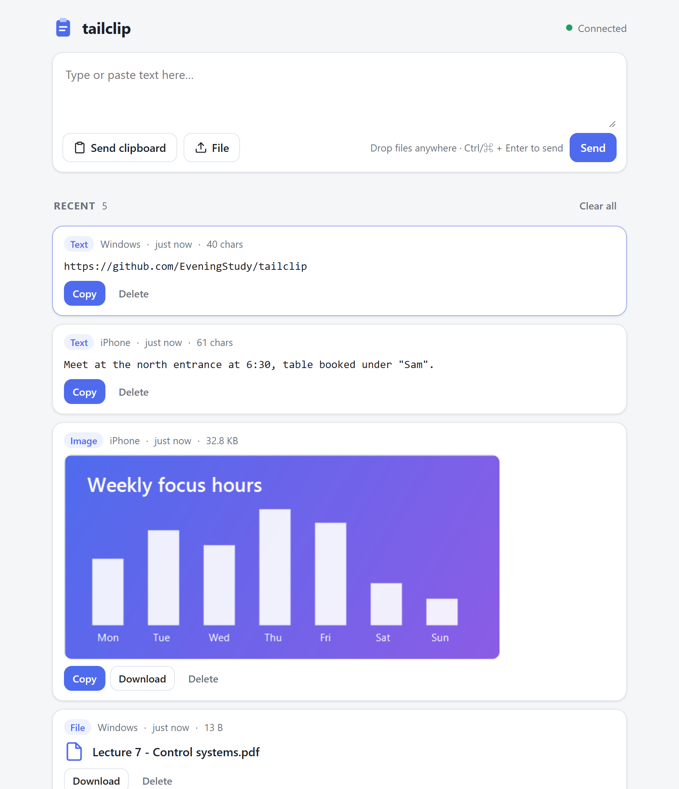
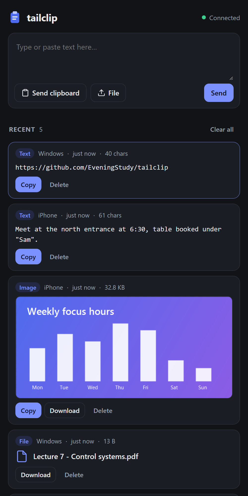
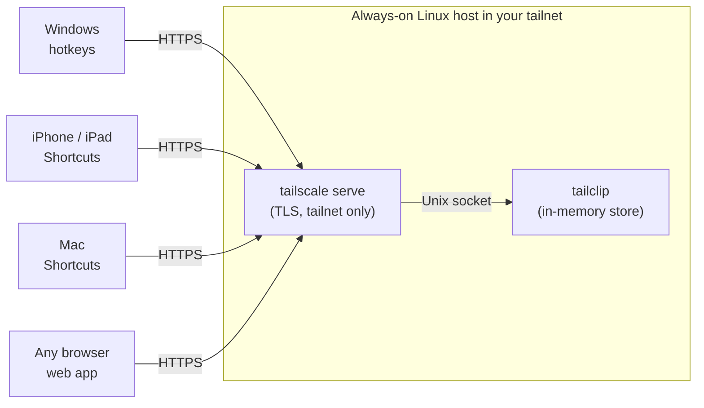

# tailclip

**A private clipboard that follows you across Windows, iPhone, iPad and Mac, over your own [Tailscale](https://tailscale.com) network.**

Copy on one device, press a hotkey (or tap the back of your phone), and paste on another. No accounts, no third-party cloud, no chat app in between. tailclip is a single Python file with no dependencies, running on any always-on machine in your tailnet.

<p align="center">
  
  &nbsp;
  
</p>

## Why

Apple devices already share a clipboard with each other. Windows doesn't share one with them, so text, screenshots and files end up going through a chat app or email to yourself. tailclip fixes that with a tiny relay that only your own devices can reach.

## Features

- **Text, images and files.** Screenshots stay images, and copied files arrive as files.
- **One-key sending and fetching**:
  - Windows: global hotkeys.
  - iPhone and iPad: Shortcuts, with an optional Back Tap gesture.
  - Mac: Shortcuts with a keyboard shortcut.
- **A web app for everything else.** It shows recent clips with one-click copy and download, plus drag-and-drop, paste-to-send, dark mode and a mobile-friendly layout.
- **Private by design:**
  - Only reachable inside your tailnet, over HTTPS via `tailscale serve`.
  - Clips are kept **in memory only**. By default it holds at most 20, and each one expires after 24 hours.
  - No request logs.
- **Small and auditable.** About 500 lines of standard-library Python, plus one HTML file.

## How it works



Your devices talk to `https://<server>.<tailnet>.ts.net`. Tailscale handles encryption, device identity and certificates. tailclip listens on a Unix socket inside a `0700` directory, so even other users and services on the same server cannot reach it. Only `tailscaled` can.

## Setup

You need Tailscale on every device, and one always-on Linux machine in the tailnet (a small VPS or a home server). [MagicDNS and HTTPS](https://tailscale.com/kb/1153/enabling-https) must be enabled for the tailnet. The first `tailscale serve` run prompts you to turn them on.

### 1. Server (Linux with systemd)

```bash
git clone https://github.com/EveningStudy/tailclip.git
cd tailclip
sudo ./deploy/install-server.sh
```

This installs the relay to `/opt/tailclip`, starts it as a hardened systemd service (`tailclip.service`), and publishes it to your tailnet with `tailscale serve`. The script prints your URL, which looks like `https://myserver.tail1234.ts.net/`. Open it in a browser on any of your devices.

Options, set in a systemd drop-in, for example `sudo systemctl edit tailclip`:

| Variable | Default | Meaning |
|---|---|---|
| `TAILCLIP_MAX_ITEMS` | `20` | Clips kept |
| `TAILCLIP_MAX_ITEM_MB` | `25` | Largest single clip |
| `TAILCLIP_MAX_TOTAL_MB` | `150` | Memory budget for all clips |
| `TAILCLIP_TTL_HOURS` | `24` | Clips expire after this |
| `TAILCLIP_ALLOWED_LOGINS` | *(empty)* | Comma-separated Tailscale logins (e.g. `you@github`). If set, other people in a shared tailnet are refused |

`install-server.sh` serves tailclip at the root of port 443 on that machine. If you already use `tailscale serve` there, run it with `--no-serve` and wire it up yourself.

### 2. Windows

```powershell
cd tailclip\clients\windows
powershell -ExecutionPolicy Bypass -File .\install.ps1 -Url https://myserver.tail1234.ts.net
```

| Hotkey | Action |
|---|---|
| `Ctrl + Alt + Shift + C` | Send this PC's clipboard (text, image, or files copied in Explorer) |
| `Ctrl + Alt + Shift + V` | Put the latest clip on this PC's clipboard |

A small notification confirms each action. When you fetch a file, or a photo format Windows can't paste (such as HEIC), it is saved to `Downloads\tailclip` and placed on the clipboard as a file, so you can paste it into any folder. The hotkeys are Start-menu shortcuts. Change them with `-PushHotkey` / `-PullHotkey`, or remove everything with `uninstall.ps1`.

### 3. iPhone and iPad (Shortcuts)

Create two shortcuts in the Shortcuts app:

**Send to tailclip**
1. **Get Clipboard**
2. **Get Contents of URL**: `https://myserver.tail1234.ts.net/api/clips`. Tap *Show More*, then set *Method* to **POST** and *Request Body* to **File**, and choose **Clipboard** as the file.
3. **Show Notification**: "Sent"

**Get from tailclip**
1. **Get Contents of URL**: `https://myserver.tail1234.ts.net/api/latest`
2. **Copy to Clipboard**
3. **Show Notification**: "Copied"

Then bind them to a gesture in **Settings → Accessibility → Touch → Back Tap**, for example double-tap to send and triple-tap to fetch. To send photos and files straight from other apps, turn on **Show in Share Sheet** for the first shortcut. Tailscale must be connected on the device.

### 4. Mac

The same two shortcuts sync to your Mac through iCloud. Open them in the Shortcuts app, click ⓘ, and choose **Add Keyboard Shortcut**.

Or skip Shortcuts and use `curl`:

```bash
pbpaste | curl -fsS --data-binary @- -H 'Content-Type: text/plain; charset=utf-8' https://myserver.tail1234.ts.net/api/clips
curl -fsS https://myserver.tail1234.ts.net/api/latest | pbcopy
```

## API

| Method & path | Description |
|---|---|
| `POST /api/clips` | Body = the clip. Text, images and other files are detected automatically. Optional headers: `X-Filename` (URL-encoded) and `X-Source` (a device label) |
| `GET /api/latest` | Raw content of the newest clip. `X-Tailclip-Kind` is `text`, `image` or `file`. Returns 404 when empty |
| `GET /api/clips` | JSON list of clips (metadata and text previews) |
| `GET /api/clips/{id}` | Raw content of one clip. Add `?download=1` to download it as an attachment |
| `DELETE /api/clips/{id}` | Delete one clip |
| `DELETE /api/clips` | Delete everything |
| `GET /healthz` | Liveness check |

## Security notes

- **Who can reach it.** Only devices in your tailnet can reach the relay. Tailscale ACLs apply as usual, and `TAILCLIP_ALLOWED_LOGINS` narrows access further in a shared tailnet. On the host, the Unix socket is unreachable for other users. The service also runs with `PrivateNetwork=yes`, a throwaway `DynamicUser` and a strict systemd sandbox; `systemd-analyze security tailclip` rates it 0.8 *SAFE*.
- **Cross-site requests.** Browsers can't write to the relay from other sites: `Sec-Fetch-Site` and `Origin` are checked for every write. This stops a malicious page from planting a command in your clipboard.
- **Uploaded content.** Uploads are never rendered as active content. Raw clips get `Content-Security-Policy: sandbox`, and anything that isn't text or a common image format is served as a download.
- **Memory only.** Clips live only in memory. Restarting the service erases them.
- **Don't use Funnel.** Never expose tailclip with `tailscale funnel`, which makes it public on the internet.

## Development

```bash
python3 server/tailclip.py --port 8790        # http://127.0.0.1:8790
python3 -m unittest discover -s tests          # end-to-end tests
```

## License

[MIT](LICENSE)
